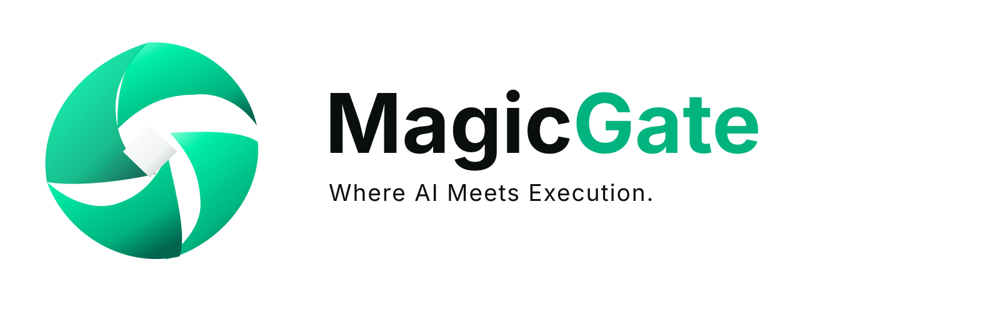
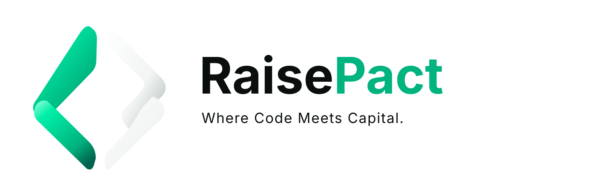

# ARKHE | Three solutions, one vision for the future

🌐 **Idioma:** [Português](ECOSSISTEMA_ARKHE.md) | [English](ECOSSISTEMA_ARKHE.en.md)

<picture><source media="(prefers-color-scheme: dark)" srcset="assets/brands/MagicGate_logo_horizontal_dark_vector.svg"></picture>

<picture><source media="(prefers-color-scheme: dark)" srcset="assets/brands/RaisePact_logo_horizontal_dark_vector.svg"></picture>

## A good idea should not get lost on the way

Imagine someone with an idea that could solve a real problem. To turn it into a business, that person needs to build a product, manage tools and access permissions, and often find partners and resources to grow.

But these steps are often scattered. One platform helps with development, another manages permissions, and a third helps prepare information for potential investors. Time, context, and clarity can disappear along the way.

**The ARKHE group is working to bring these steps closer together through three complementary solutions: MagicGate, ACCESS, and RaisePact.** They serve different purposes, can operate independently, and share a vision: help sound decisions move forward with better controls and evidence.

## Three solutions in plain language

| Solution | Problem | Proposed solution | Who benefits |
|---|---|---|---|
| **MagicGate** | Building and maintaining software involves repetitive tasks, while proving what is really complete can be difficult. | Organizes development tasks, runs controlled steps, checks results, and records evidence. | Engineering teams, startups, and software companies. |
| **ACCESS** | Using different AI tools and services without clear rules creates confusion, cost, and risk. | Organizes authorization decisions and usage limits: who may access what, what tools may do, and when actions must be blocked. | Teams and organizations needing accountability and control. |
| **RaisePact** | Founders waste time looking for investors without knowing whether they fit or how to substantiate a project. | Structures information, preserves evidence sources, and helps assess projects and identify potentially aligned investors. | Founders, project leaders, and fundraising professionals. |

## How they fit together

Consider a company building a digital product.

**First: turn an idea into a product.** MagicGate helps organize technical work and verify what has been delivered. Rather than simply saying “it is done,” the goal is to show what happened and what supports that claim.

**Second: establish clear rules.** ACCESS supports the governance of permissions and AI tools. It helps determine what is authorized, what requires human intervention, and what should be denied.

**Third: prepare an informed conversation about growth.** RaisePact organizes evidence and assessment criteria so founders and investors can consider an opportunity with better context — without mistaking potential for proven results.

**The integrated vision:** authorized, verifiable information may eventually help connect development, governance, and project assessment with less repeated work. **This does not mean all three systems are fully integrated today or that private information moves automatically between them.** Every integration requires appropriate permissions, technical contracts, validation, and disclosure controls.

## What does this mean for people?

For founders, the proposed benefit is a clearer path to build, track, and present a business.

For software companies, the proposed benefit is more predictable work with stronger controls and verifiable results.

For investors, the value is the prospect of clearer information: which problem is being solved, what has been built, what risks remain, and what still needs to be proven.

**ARKHE is not trying to replace human judgment.** It is working to improve the information and processes people use to make decisions.

## A business opportunity developed in stages

MagicGate has a documented introductory commercial reference: **a 10-day evaluation period, followed by a reference price of US$ 19 per month**. The complete onboarding, billing, and licensing infrastructure is still subject to operational validation; this price is not presented as achieved revenue.

ACCESS provides a governance layer with potential applications for organizations managing tools and access consistently.

RaisePact proposes software for researching, assessing, and connecting projects with investors. Its commercial development depends on validating demand, data quality, privacy, and applicable legal requirements.

**We do not publish customer counts, revenue, financial returns, company valuations, or live integration claims without appropriate evidence.** Commercial potential is a hypothesis to test, not a promise of returns.

## Current stage and next steps

- **MagicGate:** has a documented technical core, execution tooling, and security controls; distribution and commercial operations are progressing through validation stages.
- **ACCESS:** has technical policy and control components; live external connections and release require separate setup and validation.
- **RaisePact:** has an evidence-based analysis and prioritization core; parts of the full fundraising experience and cross-product integration remain under development.
- **Ecosystem integration:** shares a direction on security and evidence; complete links between the three solutions will only be announced after end-to-end verification.

## An invitation to investors

**What if the next promising business could be built with more control and presented with greater clarity?**

ARKHE welcomes conversations with investors and strategic partners interested in software, applied AI, business tools, and better ways to connect innovation with capital.

You do not need to understand programming to start a conversation. We want to discuss **the problems we address, how each product may create value, the actual development stage, the risks, and the milestones needed to prove the business model**.

**[Learn about MagicGate and contact us through its official channel](https://magicgate.dev)**. The [RaisePact institutional website](https://raisepact-vnlcwb.v2.appdeploy.ai/) also introduces the product's proposition.

*This is an institutional overview. It is not a public securities offering, investment promise, guaranteed return, or proof of complete production integration. Private materials are shared only when authorized.*
