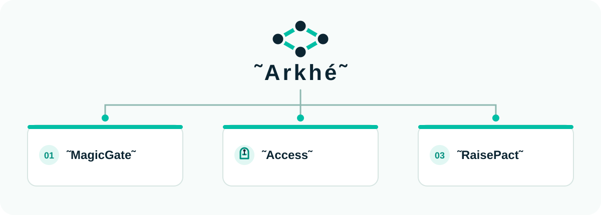
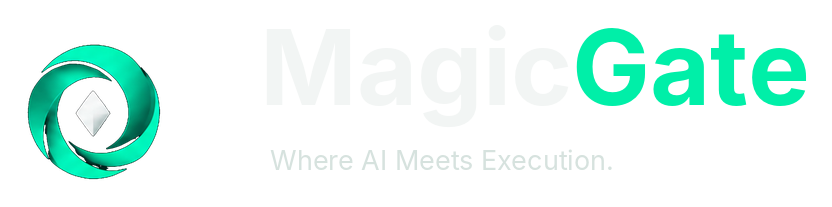
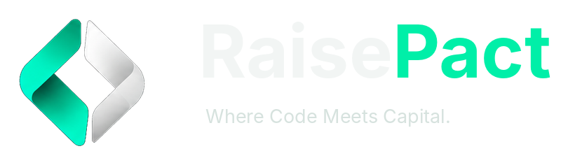

# Arkhé — ideias extraordinárias merecem chegar mais longe

**Da ideia à tecnologia. Da tecnologia à confiança. Da confiança ao crescimento.**

🌐 **Idioma:** [Português](README.md) · [English — edição anterior, em revisão](README.en.md)

> **ARKHÉ** é um grupo independente de soluções de tecnologia que enfrenta três obstáculos reais de quem constrói e expande negócios: **executar software com qualidade**, **controlar o uso de ferramentas inteligentes** e **preparar projetos para conquistar oportunidades de crescimento**.

## O problema que queremos resolver

Uma grande ideia pode fracassar antes mesmo de chegar ao mercado — não porque lhe falte potencial, mas porque transformar visão em produto exige esforço, controle, recursos e decisões difíceis.

O desenvolvimento se perde em tarefas repetitivas. O uso crescente de IA cria dúvidas sobre segurança, autorização e custos. E, quando chega o momento de apresentar o negócio, informações dispersas tornam difícil demonstrar sua qualidade, seus riscos e seu potencial.

**Não basta ter uma ideia. É preciso construir, proteger e demonstrar seu valor.**

## A resposta da Arkhé

**Três desafios. Três soluções especializadas. Uma visão de futuro.**

A Arkhé reúne **MagicGate**, **Access** e **Raise Pack**. Cada produto resolve um problema específico e preserva sua autonomia. Juntos, compõem uma visão de jornada tecnológica mais contínua, com controles, evidências e decisões humanas onde elas realmente importam.

<!-- Diagrama conceitual de ecossistema. Não é logomarca aprovada da holding nem prova de integração operacional. -->

| Sua necessidade | A solução | Valor proposto |
| --- | --- | --- |
| **Construir com menos fricção** | **MagicGate** | Orquestrar tarefas de engenharia e validar entregas com evidências. |
| **Operar IA com mais controle** | **Access** | Definir permissões, limites e decisões de autorização. |
| **Preparar-se para crescer** | **Raise Pack** | Organizar e avaliar projetos e oportunidades com critérios rastreáveis. |

**Visão conjunta:** uma jornada que vai da construção técnica à governança e à apresentação de oportunidades de investimento. **A integração completa dos três produtos é uma direção de desenvolvimento, não uma capacidade já comprovada em produção.** Nenhum dado privado é compartilhado automaticamente entre eles.

## MagicGate — transforme intenção em execução verificável

### A dor

Criar software não é apenas escrever código. É organizar dependências, executar processos, testar, corrigir falhas, retomar trabalhos interrompidos e provar que a entrega realmente funciona. Esse trabalho operacional consome tempo valioso de equipes e desenvolvedores.

### A solução

O **MagicGate** organiza a engenharia de software em planos, execução controlada, testes, validações e evidências. Seu objetivo é ampliar a capacidade operacional sem transformar automação em uma caixa-preta.

**Planejar → executar → testar → validar → registrar → medir → evoluir.**

**O que a baseline documentada oferece:** planos determinísticos, CLI, retomada e persistência de estado, Runtime Doctor, SafetyPolicy, CostGuard, métricas operacionais e MGPI, além de uma linha privada do VS Code Control Center. Compatibilidade, distribuição e disponibilidade comercial dependem dos respectivos gates.

**Para quem:** desenvolvedores, startups, software houses e equipes de engenharia que querem menos esforço repetitivo e mais confiança na entrega.

**[Conheça o MagicGate](https://magicgate.dev)**

## Access — inteligência precisa de limites claros

<!-- Arte conceitual disponível no repositório; aprovação como logomarca oficial ainda não comprovada. -->

### A dor

Quanto mais equipes dependem de IA, integrações e serviços digitais, maior é a necessidade de responder: **quem pode acessar, quais ações são permitidas, o que precisa de aprovação e o que deve ser bloqueado?**

Sem regras previsíveis, a automação pode multiplicar riscos em vez de gerar eficiência.

### A solução

O **Access** é a proposta de uma camada de governança de permissões e capacidades. Busca tornar explícitas as condições de uso das ferramentas: permitir quando autorizado, solicitar intervenção humana quando necessário e negar operações fora das políticas.

**Para quem:** equipes e organizações que precisam adotar inteligência artificial com responsabilidade, rastreabilidade e limites operacionais.

**Estado:** possui código e contratos próprios; integrações e operação externa devem ser comprovadas separadamente, não presumidas a partir desta apresentação.

## Raise Pack — transforme potencial em uma oportunidade compreensível

<!-- Arte proveniente do kit de marca anterior, com integridade de arquivo verificada. A tipografia/nome no ativo precisa de nova aprovação para a identidade pública Raise Pack. -->

### A dor

Ter uma boa solução não significa conseguir apresentá-la ao investidor certo. Fundadores frequentemente enfrentam pesquisa dispersa, dificuldade para comprovar diferenciais, pouca clareza sobre riscos e falta de critérios para identificar oportunidades compatíveis.

**Potencial sem organização fica difícil de compreender. Evidência sem contexto fica difícil de avaliar.**

### A solução

O **Raise Pack** trabalha a estruturação e a avaliação de projetos para captação: organiza evidências, critérios, maturidade, riscos e compatibilidade com perfis de investidores. Sua visão é apoiar apresentações mais claras e decisões mais informadas.

O método distingue **qualidade do projeto, potencial futuro, compatibilidade com investidores, confiança das evidências e estimativas econômicas**. Projeções não se confundem com receita real; avaliações integrais e valuation indicativo dependem de pesquisa suficiente e validação apropriada.

**Para quem:** fundadores, startups, equipes de inovação e profissionais que preparam projetos para parcerias e investimentos.

**[Conheça a apresentação atual do produto](https://raisepact-vnlcwb.v2.appdeploy.ai/)**

## Por que isso importa para investidores e parceiros?

A Arkhé propõe uma conexão entre três necessidades que costumam ser tratadas separadamente: **capacidade de construir, responsabilidade para operar e clareza para crescer**.

Buscamos conversas com parceiros que possam contribuir com experiência em desenvolvimento de software, infraestrutura, governança de IA, SaaS B2B, pesquisa de mercado e expansão comercial.

**Oportunidade não é promessa:** não divulgamos clientes, faturamento, retorno financeiro, valuation, integração integral ou desempenho universal sem evidência. Materiais confidenciais permanecem sob controle de acesso e divulgação específica.

## Status e transparência

- **MagicGate:** possui baseline técnica e artefatos privados; novos releases, plataformas, cobrança e publicação requerem homologação específica.
- **Access:** componentes e contratos de governança; integrações e disponibilização externa dependem de validação.
- **Raise Pack:** base de avaliação e documentação; a experiência integral de pesquisa, captação e integração continua sujeita a desenvolvimento e gates próprios.
- **Grupo Arkhé:** três soluções autônomas, com uma direção de integração — **não um pacote único já homologado**.

### Kit de marca — o que é validado e o que ainda precisa de aprovação?

**Arquivos de origem conferidos:** as logomarcas MagicGate e do kit anterior do produto de captação, já presentes em `assets/brands/`, têm conteúdo binário idêntico ao dos kits entregues pelo proprietário. Isso valida a **proveniência do arquivo**, não constitui nova aprovação de renomeação nem certificação de registro marcário.

**Ainda não aprovados como logos finais:** o diagrama `ARKHE_ecosystem.svg` é uma ilustração; `Access_identity.svg` é uma proposta de identidade, não há comprovação de sua aprovação como logomarca oficial. O lettering da arte anterior do produto de captação deverá ser atualizado e aprovado para a marca **Raise Pack** antes de ser denominado identidade final atual.

Não confundir mockups ilustrativos, diagramas de relacionamento, derivativos SVG ou arquivos históricos com **logomarcas oficiais homologadas**. A substituição de ativos exige matriz de origem, conferência visual do proprietário e testes de renderização.

## Documentação e contato

**[Visão ampliada do ecossistema](ECOSSISTEMA_ARKHE.md)** · **[MagicGate](https://magicgate.dev)** · **[Raise Pack](https://raisepact-vnlcwb.v2.appdeploy.ai/)**

[Segurança](SECURITY.md) · [Governança](GOVERNANCE.md) · [Divulgação pública](DISCLOSURE_POLICY.md) · [Validação de métricas](METRICS_VALIDATION_POLICY.md) · [Suporte](SUPPORT.md)

**ARKHÉ — construir com evidência, operar com controle, crescer com clareza.**
