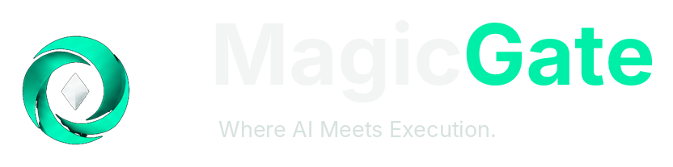

# MagicGate

🌐 **Idioma:** [Português](README.md) | [English](README.en.md)

## ARKHE: tecnologia que transforma ideias em oportunidades

**Uma boa ideia precisa de três coisas: ser construída, ser bem administrada e encontrar caminhos para crescer.** Hoje, essas etapas frequentemente ficam desconectadas. É para aproximá-las que o grupo ARKHE desenvolve três soluções complementares.

| Ferramenta | Explicação simples |
|---|---|
| **MagicGate** | Ajuda equipes a transformar planos de software em entregas verificáveis, com menos tarefas manuais e mais controle. |
| **ACCESS** | Define regras para o uso de ferramentas e serviços de inteligência artificial, protegendo permissões e decisões importantes. |
| **RaisePact** | Ajuda projetos a organizar evidências, avaliar sua preparação e identificar possíveis investidores com critérios mais claros. |

**Como trabalham juntas?** O MagicGate apoia a construção do produto. O ACCESS orienta quem pode acessar ferramentas e o que está autorizado. O RaisePact oferece uma forma mais estruturada de apresentar e analisar oportunidades de crescimento.

As três soluções têm responsabilidades independentes. **A integração completa é uma visão em desenvolvimento, não um serviço já comprovado em produção.** Dados privados não são compartilhados automaticamente, e toda conexão depende de permissões, segurança e validação.

**Para investidores e parceiros:** buscamos conversas sobre uma oportunidade de construir soluções de software com evidências, governança e potencial de escala. Não prometemos retorno financeiro, clientes ou faturamento que ainda não foram comprovados.

**[Conheça a história, os problemas, as soluções e o convite ao investidor](ECOSSISTEMA_ARKHE.md)** · [Site MagicGate](https://magicgate.dev) · [Conheça o RaisePact](https://raisepact-vnlcwb.v2.appdeploy.ai/)

---

## Detalhamento do produto MagicGate

## Transforme planos de software em execução verificável

**Da intenção à execução. Da execução à evidência. Da evidência à escala.**

MagicGate é uma camada de execução para engenharia de software criada para reduzir o trabalho operacional entre **decidir o que precisa ser feito** e **comprovar que foi feito corretamente**.

Em vez de tratar automação como uma caixa-preta, o MagicGate organiza a entrega em planos determinísticos, executa tarefas sob controles de segurança, valida resultados, persiste estado e produz evidências e métricas observáveis.

> **Release de produto:** v0.3.0  
> **VS Code Control Center:** release privada 0.1.1  
> **Site oficial:** [magicgate.dev](https://magicgate.dev)  
> **Código-fonte:** privado por design

## O problema

Equipes de software perdem capacidade em tarefas que não deveriam consumir o melhor tempo de engenharia: coordenar etapas repetitivas, conferir dependências, retomar execuções interrompidas, reunir evidências, validar gates, acompanhar progresso e reconstruir o que aconteceu depois de uma automação.

Ferramentas de IA aceleram a produção de código, mas velocidade sem controle cria uma nova pergunta: **como transformar intenção em entrega reproduzível, auditável e segura?**

O MagicGate foi construído para ocupar exatamente esse espaço.

## A proposta

O fluxo do MagicGate é simples de explicar e rigoroso na execução:

**definir → planejar → executar → testar → validar → registrar → medir → evoluir**

O objetivo não é substituir julgamento de engenharia. É ampliar a capacidade do time removendo trabalho operacional repetitivo e tornando a automação mais controlável.

### Para equipes de engenharia

- menos coordenação manual entre etapas de uma entrega;
- retomada de execuções com estado persistido;
- progresso derivado de tarefas realmente concluídas;
- evidências para auditoria e diagnóstico;
- métricas de autonomia, qualidade, retries e intervenção humana;
- integração com fluxos de desenvolvimento existentes.

### Para startups e software houses

- mais capacidade operacional sem depender de uma camada crescente de processos manuais;
- padronização de execução entre projetos;
- visibilidade sobre o que a automação fez e por quê;
- controle explícito de custo e segurança;
- base para escalar automação sem abrir mão de governança.

### Para organizações com requisitos de controle

- comportamento fail-closed;
- SafetyPolicy e CostGuard;
- proteção contra ações destrutivas e material com aparência de segredo;
- confinamento ao workspace autorizado;
- evidência observável como requisito de conclusão;
- separação entre automação e decisões humanas críticas.

## O que já existe

A baseline v0.3.0 reúne uma camada operacional de execução, não apenas uma demonstração conceitual:

- CLI canônica;
- planos determinísticos `magicgate-plan-v1`;
- ordenação de tarefas e dependências;
- execução controlada e retomada;
- persistência de estado;
- evidências obrigatórias para conclusão;
- Runtime Doctor;
- SafetyPolicy e CostGuard;
- métricas operacionais e MagicGate Productivity Index (MGPI);
- validação de releases;
- baseline técnica do Remote Link;
- Investor Hunter com scoring determinístico e controles de divulgação;
- VS Code Control Center privado, com Doctor, Run Plan, Resume, Safety, Metrics e Active Plans.

## Evidência antes de promessa

O MagicGate adota uma regra comercial e técnica deliberadamente simples:

> **execução real + evidência observável = métrica validada**

Resultados públicos são apresentados como observações das execuções que os produziram — não como garantia universal de desempenho.

| Evidência registrada | Resultado observado |
|---|---:|
| Control Center — plano de 3 tarefas | progresso canônico 33% → 66% → 100% |
| Bateria funcional registrada | 100% de sucesso e autonomia |
| Remote Link — baseline v0.3.0 | 58/58 testes aprovados, typecheck e build aprovados |
| Execução operacional adicional | 14,90 s, 100% de autonomia e 0 s de intervenção humana |
| MGPI em execuções registradas | 99,97–99,99 |

Comparações humano-equivalentes, projeções econômicas e ganhos futuros permanecem classificados como estimativas até que benchmarks comparáveis sustentem conclusões mais amplas.

## MagicGate no VS Code

O Control Center aproxima o ciclo de execução do ambiente em que o desenvolvedor já trabalha. A release privada **0.1.1** da extensão VS Code está empacotada e integra os fluxos principais do MagicGate.

O projeto mantém uma distinção importante entre disponibilidade do artefato e validação de plataforma: o launcher Windows foi implementado e empacotado, enquanto a aprovação E2E Windows permanece condicionada à cadeia completa de instalação, ativação, launcher e execução verificável.

Essa disciplina evita transformar “funciona em teoria” em alegação comercial.

## Segurança por design

Automação útil precisa ter limites previsíveis. O MagicGate incorpora controles para que velocidade não dependa de reduzir segurança:

- execução restrita ao workspace autorizado;
- allowlist de executáveis;
- bloqueio de ações destrutivas;
- bloqueio de material com aparência de segredo;
- CostGuard para impedir consumo externo não autorizado;
- autenticação ChatGPT delegada ao Codex CLI, sem custódia de tokens pelo MagicGate;
- conclusão condicionada a evidências;
- divulgação externa sujeita a governança específica.

## Oferta de lançamento

A referência comercial inicial definida para validação é direta:

| Oferta | Condição |
|---|---:|
| Avaliação | **10 dias grátis** |
| Assinatura após o trial | **US$ 19/mês** |
| Renovação | mensal |

A infraestrutura comercial de cadastro, elegibilidade, cobrança, licenciamento, API Keys e consoles está no roadmap de lançamento. Nenhuma cobrança é apresentada como ativa antes dessa camada estar operacional e validada.

## Por que MagicGate

A tese do produto não é “IA escreve código”. O mercado já está provando que modelos conseguem ajudar nisso.

A tese do MagicGate é outra: **quanto mais execução é delegada à automação, mais valiosa se torna a camada que controla, valida, registra e mede essa execução.**

MagicGate foi desenhado para ser essa camada entre intenção e entrega verificável.

## Investidores e parceiros estratégicos

O MagicGate está aberto a conversas com investidores e parceiros que compartilhem a visão de uma engenharia de software com mais automação, evidência e controle.

Buscamos especialmente experiência e distribuição em:

- developer tools e infraestrutura de engenharia;
- inteligência artificial aplicada ao ciclo de software;
- SaaS B2B;
- segurança e governança de automação;
- distribuição para startups, software houses e equipes de engenharia;
- expansão internacional.

Materiais privados são compartilhados de forma controlada. Código-fonte, credenciais, dados pessoais, arquitetura interna e informações confidenciais não fazem parte da divulgação pública.

**Produto, parceria ou investimento:** acesse [magicgate.dev](https://magicgate.dev) e utilize o canal oficial de contato.

## Roadmap de alto nível

O próximo ciclo concentra-se em distribuição comercial controlada: evolução do Control Center e Remote Link, benchmarks comparáveis, camada de cadastro/licenciamento/cobrança, Customer Console, Admin Console e telemetria sanitizada.

Cada promoção continua condicionada aos gates técnicos e de segurança aplicáveis.

## Documentação pública

- [Licença](LICENSE.md)
- [Política de segurança](SECURITY.md)
- [Política de divulgação pública](DISCLOSURE_POLICY.md)
- [Política de validação de métricas](METRICS_VALIDATION_POLICY.md)
- [Governança](GOVERNANCE.md)
- [Contribuição](CONTRIBUTING.md)
- [Código de conduta](CODE_OF_CONDUCT.md)
- [Suporte](SUPPORT.md)

---

### Plan. Execute. Measure. Scale.

**MagicGate — transforme automação em execução que você pode verificar.**
